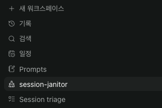
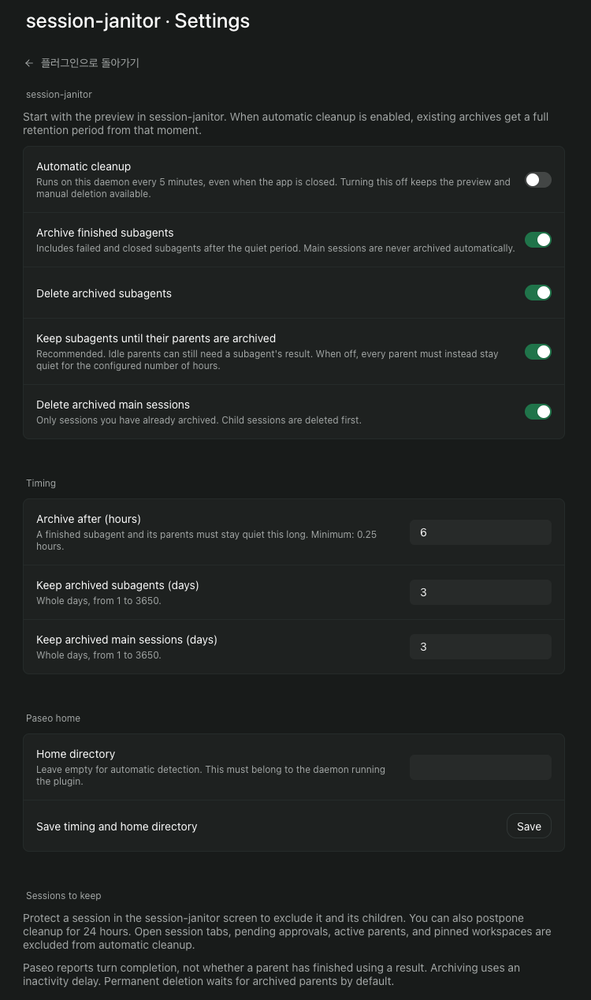

# session-janitor

Clean up finished Paseo subagents and archived sessions without keeping a separate cleanup script running.

## What it does

- Archives finished, failed, or closed subagents after **6 hours** of inactivity. Their parents must also be quiet.
- Deletes archived subagents after **3 days**. By default, every parent must already be archived.
- Deletes archived main sessions after **3 days**. Main sessions are never archived automatically.
- Provides **Delete this session…** in the Command Center. Review the session and its children, then type `DELETE` to remove them immediately.
- Lets you protect a session and its children, or postpone cleanup for 24 hours.
- Shows scheduled actions, reasons for keeping a session, and recent cleanup results.

All timing values can be changed in settings. The plugin starts in **preview mode**. Automatic archiving and deletion stay off until you enable them.

## Install

Requires the Paseo **0.11.4–0.11.x** daemon and app. On the daemon machine:

```sh
paseo plugin install github:sm1ee/paseo-session-janitor --ref v0.1.1
```

Open **session-janitor** in the sidebar above the workspace list, alongside Session triage. Use **Settings** at the top of its screen to change cleanup rules. Review **All sessions** to see exclusions, then open **Settings → Plugins → session-janitor** to enable automatic cleanup.

Existing archives receive a full retention period when automation is enabled. Disabling and re-enabling automation starts that period again. Turning it off does not restore sessions already deleted.

## Cleanup rules

The daemon checks every five minutes, including when the app is closed. Refreshing a large session directory runs in the background, so the screen stays responsive. Finished means Paseo reported a completed or failed turn, or the runtime is closed. An idle session alone does not qualify.

Before each operation, the plugin checks the session, its parent chain, open tabs, pending permissions, and child sessions again. A session with an active or unknown parent is kept. Child sessions are handled before their parents. A reconnect requires another observation before automatic changes resume.

Protection and postponement apply to the whole descendant tree. Open session tabs and pinned active workspaces are excluded from automatic cleanup. Once the plugin observes a pinned workspace, it remembers the exclusion if the workspace is later archived. Pins on workspaces already archived before the plugin first saw them are not exposed by Paseo; use **Protect** for those sessions.

Paseo does not report whether a parent has finished using a result. The archive delay is an inactivity rule. Permanent subagent deletion therefore waits for archived parents by default. You can turn that requirement off; the configured inactivity delay then applies to every parent instead.

Manual deletion can remove an unarchived main session. It includes the visible Paseo-managed child tree, blocks active sessions, pending approvals, protected sessions, and open child tabs, and expires the confirmation after five minutes. The selected main session's own tab may remain open. A changed tree requires a new review. Confirmed deletion runs in the background and reports progress. A single deletion is limited to 50 sessions; larger trees must be cleaned in smaller branches. If part of a deletion succeeds before another session changes, the remaining sessions are kept and the screen reports how many were deleted.

Paseo 0.11 does not offer a conditional delete or archive request. The plugin rechecks immediately before sending a request, but those reads and the mutation are separate operations.

## What gets deleted

Permanent deletion removes the session's **Paseo record and Paseo conversation history**. It does not delete project directories, files, worktrees, or workspaces. Provider CLI history may remain in that provider's own storage.

This plugin manages sessions created through Paseo. Subagents created privately inside a provider CLI are outside its scope. Removing the plugin does not restore deleted records.

The plugin writes a receipt before each mutation and verifies the result afterwards. An uncertain operation is excluded from automatic retries until its result can be verified. Recent history is capped at 100 entries; unresolved receipts are retained separately. Review a kept session manually if a receipt remains unresolved.

## Local data

Settings are shared by clients connected to the same host. Session metadata, protection choices, postponements, observations, and cleanup receipts stay under that daemon's `plugin-data/paseo-session-janitor/` directory with owner-only file permissions. No prompts or conversation bodies are read by the plugin. It sends no data to an external service.

Paseo's local credential is read only to authenticate to the plugin's own daemon. It is not copied into settings or logs. The plugin accepts only a local socket or loopback listener and checks the daemon identity. A worker lock prevents two installations from cleaning the same daemon at once.

Permanent deletion and background startup currently use the version-pinned `@getpaseo/client` adapter because Paseo's public plugin SDK does not expose those operations. The supported version range is capped at 0.11.x for that reason.

If another cleanup script is installed, review its policy before enabling this plugin. session-janitor does not disable or change other cleaners.

## Development

```sh
npm ci --ignore-scripts
npm run typecheck
npm test
```

Tests use an in-memory host and temporary plugin-owned files. They never delete existing Paseo sessions.

## Screenshots





Captured from Paseo and cropped to omit host and session details.
